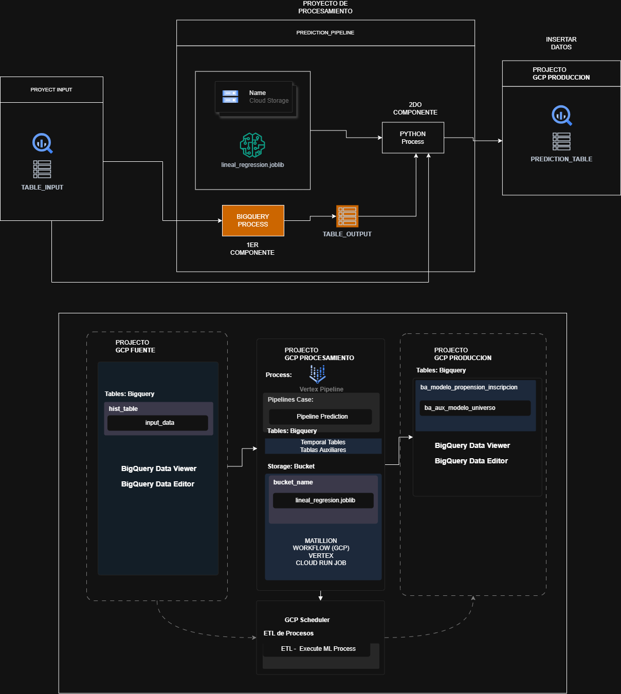

# ML Pipeline Prediction on GCP

## Overview

This project provisions foundational Google Cloud Platform (GCP) infrastructure for a planned housing-price prediction pipeline. Terraform creates the projects, BigQuery datasets, Cloud Storage bucket, enables required APIs, and configures permissions. 

## Architecture

The diagram shows the planned architecture for the end-to-end machine learning pipeline.



#### Project components

The planned design uses the following components:

*GCP projects:*
- `source`: Intended for raw housing data in BigQuery.
- `process`: Intended for data processing, model training, and artifact storage.
- `production`: Intended for production datasets and predictions.

The projects separate data ingestion, processing, and production responsibilities.

*BigQuery datasets:*
- `bq_housing_source`: Dataset provisioned for raw housing data.
- `bq_housing_process`: Dataset provisioned for processed training data.
- `bq_housing_prod`: Dataset provisioned for production data and predictions.

*Cloud Storage buckets:*
- `<process-project-id>-artifacts`: Bucket provisioned for pipeline artifacts.

*Planned Vertex AI pipeline:*
- Will orchestrate data processing and predictions from the pretrained model.

*Planned Cloud Run Job:*
- Will invoke the compiled pipeline to serve predictions.

*Planned Cloud Scheduler:*
- Will trigger the Vertex AI pipeline and Cloud Run Job at specified intervals.

*Pipeline service account:*
- Terraform manages this service account in the `process` project and grants the permissions listed below.
- If you provide an email in `terraform.tfvars` and it does not exist yet, Terraform creates it; if it already exists, Terraform reuses it.

*Cloud Run launcher service account:*
- Terraform manages this service account in the `process` project and grants permissions to submit Vertex AI pipeline jobs, read pipeline templates from the artifacts bucket, and use the pipeline service account.
- If you provide an email in `terraform.tfvars` and it does not exist yet, Terraform creates it; if it already exists, Terraform reuses it.

## Infrastructure Setup (Terraform)

### Step by step
1. Authenticate in GCP:
```bash
gcloud auth application-default login
```
2. Go to Terraform folder:
```bash
cd infra/terraform
```
3. Copy and edit variables:
```bash
cp terraform.tfvars.example terraform.tfvars
```
4. Initialize Terraform:
```bash
terraform init
```
5. Validate configuration:
```bash
terraform validate
```
6. Create and review plan:
```bash
terraform plan -out=tfplan
```
7. Apply resources:
```bash
terraform apply tfplan
```

### What gets created
- 3 GCP projects: `source`, `process`, `production`
- Required APIs per project:
	- In `source`: BigQuery
	- In `production`: BigQuery
	- In `process`: BigQuery, BigQuery Storage API, Cloud Storage, Cloud Run, Cloud Scheduler, Vertex AI, Cloud Build, Artifact Registry
- 3 BigQuery datasets:
	- `bq_housing_source`
	- `bq_housing_process`
	- `bq_housing_prod`
- 1 BigQuery table in `source` dataset:
	- `input_table` (configurable with `source_input_table_id`)
- 1 GCS bucket in `process`, named `<process-project-id>-artifacts`
- 1 Artifact Registry Docker repository in `process`:
	- ID configurable with `artifact_registry_repository_id` (default: `test`)

### Permissions (pipeline service account)
- In `source` dataset (`bq_housing_source`):
	- `roles/bigquery.dataViewer`
- In `process` dataset (`bq_housing_process`):
	- `roles/bigquery.dataEditor`
- In `production` dataset (`bq_housing_prod`):
	- `roles/bigquery.dataEditor`
- In `process` project:
	- `roles/bigquery.jobUser`
	- `roles/bigquery.readSessionUser`
	- `roles/aiplatform.user`
- In `production` project:
	- `roles/bigquery.jobUser`
- On artifacts bucket (`<process-project-id>-artifacts`):
	- `roles/storage.objectViewer`
	- `roles/storage.objectCreator`

### Permissions (Cloud Run launcher service account)
- In `process` project:
	- `roles/aiplatform.user`
	- `roles/run.invoker`
- On artifacts bucket (`<process-project-id>-artifacts`):
	- `roles/storage.objectViewer`
- On pipeline service account:
	- `roles/iam.serviceAccountUser`

Notes:
- Service accounts are managed in the `process` project.
- You can provide service account emails or fallback account IDs; in both cases Terraform ensures accounts exist and then applies IAM bindings.

Configure these in `terraform.tfvars`:

- `pipeline_service_account_id`
- `pipeline_service_account_display_name`
- `cloud_run_service_account_id`
- `cloud_run_service_account_display_name`

or set the service account emails directly:

- `pipeline_service_account_email`
- `cloud_run_service_account_email`

Notes:
- If both the service account email and fallback account ID are provided, Terraform will prioritize the email. Ensure that the email correspond to `<process-project-id>` service accounts, since Terraform manages them in the `process` project.

## Project Execution

After Terraform provisioning, execute the runtime workflow (data load, pipeline compilation, image build, job deploy, test run, and scheduler setup).

### Recommended: Makefile + scripts

1. Copy deploy variables template:
```bash
cp .env.deploy.example .env.deploy
```
2. Edit `.env.deploy` with your values.
3. Ensure your job env file exists (default: `.env`) with required runtime variables.
```bash
cp .env.example .env
```
4. Run all steps:
```bash
make all
```

Available stages:

- `make data`
- `make pipeline`
- `make image`
- `make job`
- `make test`
- `make schedule`

Use a custom deploy file if needed:
```bash
ENV_FILE=/path/to/.env.deploy make all
```

### Manual alternative

If you prefer direct commands, see `commands-manual.txt` and execute in this order:

1. Load initial data to BigQuery.
2. Compile and upload pipeline JSON to GCS.
3. Build container image.
4. Deploy Cloud Run Job.
5. Execute a test run.
6. Create or update Cloud Scheduler.

